

# Kalendra Website

**The public landing and early-access site for Kalendra, an AI scheduling assistant: a single-page React site with hand-built SVG, CSS and JavaScript animation, a waitlist form, and in-page legal notices.**

### [Live website: getkalendra.com](https://getkalendra.com/)

**Desktop · Mobile web** 
React 18 · Vite 5 · GSAP ScrollTrigger · EmailJS · Plain CSS · Netlify

<table>
  <tr>
    <td>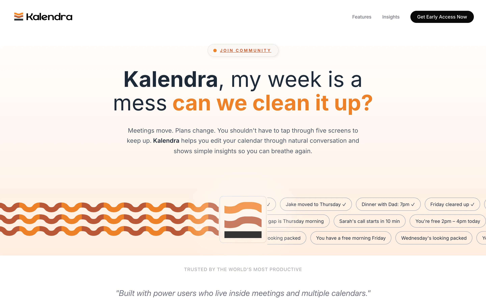</td>
  </tr>
</table>
Real captures from the live site at 1440 by 900. Animated sections are frozen at one moment in their loop.

---

## Product at a Glance

| | |
|---|---|
| **What it is** | Marketing and waitlist site for Kalendra, an assistant that edits calendars through conversation |
| **Public site** | [getkalendra.com](https://getkalendra.com/), served by Netlify (confirmed from response headers) |
| **Shape** | One page, seven content sections plus header and footer, no router and no backend of its own |
| **Conversion goal** | Collect an email, role and phone OS for early access through a form |
| **Legal pages** | Privacy Policy and Terms open as modal dialogs from `#privacy` and `#terms` |
| **Animation** | SVG, CSS keyframes, `requestAnimationFrame` and GSAP, with no video or Lottie files |
| **Build output** | About 334 kB of JavaScript (114 kB gzipped) and 33 kB of CSS in a clean production build |
| **Source size** | 26 components and 26 stylesheets, roughly 3,500 lines |
| **Product status** | The app is pre-release; the site says so and the store badges are hidden |

## Screenshots

<table>
  <tr>
    <td align="center">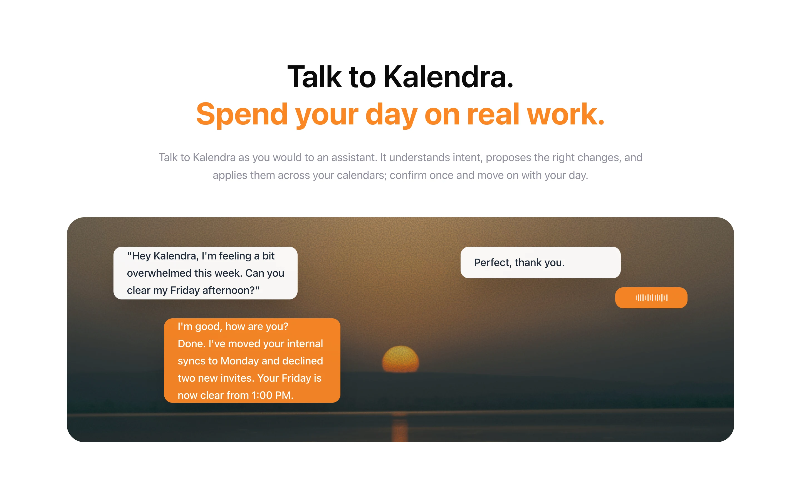 <b>Conversation demo</b> Bubbles expand from a waveform and type in sequence</td>
    <td align="center">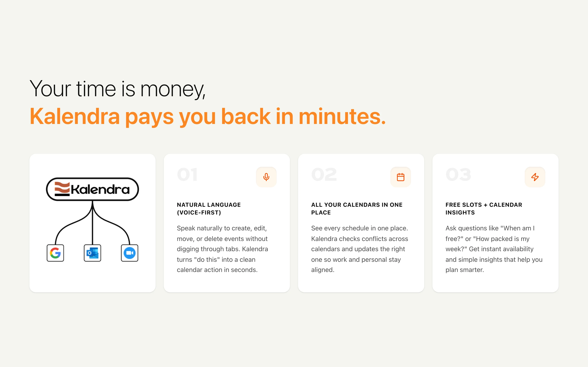 <b>Capabilities</b> Logo expands and draws lines to integrations</td>
  </tr>
  <tr>
    <td align="center">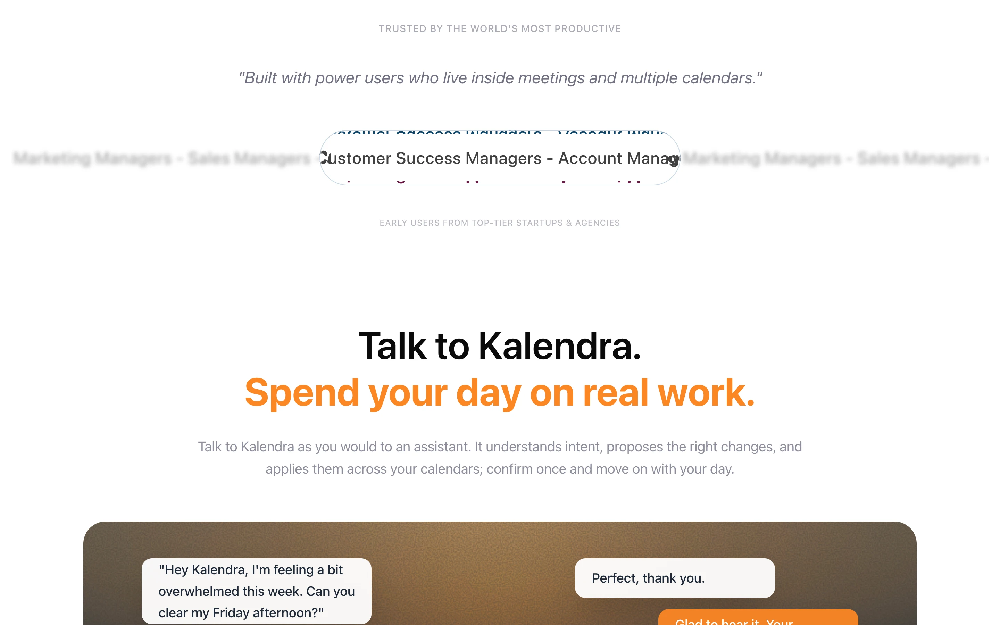 <b>Glass lens ticker</b> SVG displacement filter over scrolling text</td>
    <td align="center">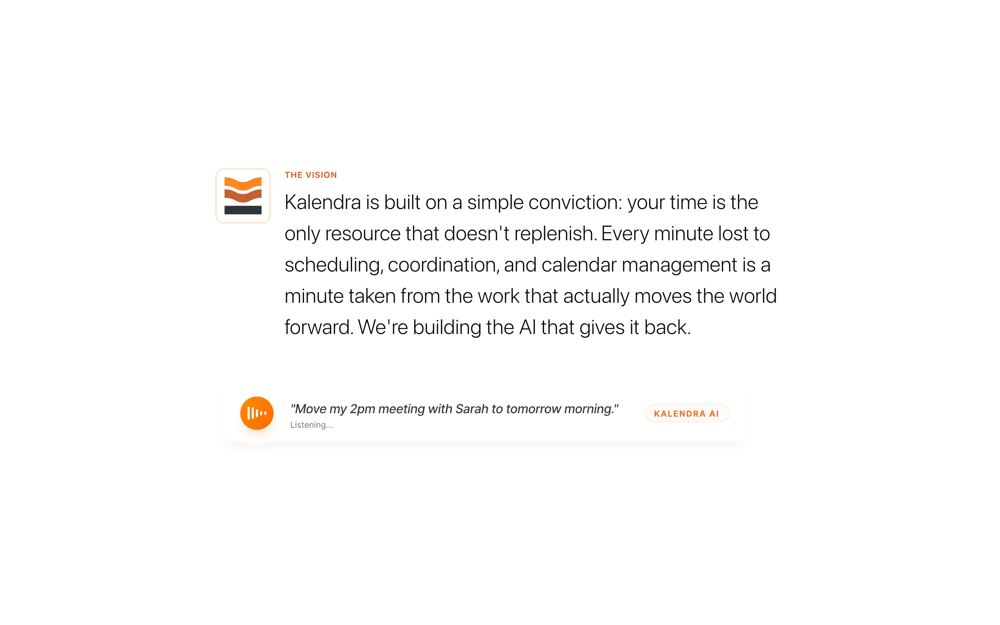 <b>Vision</b> Typewriter statement and a voice prompt card</td>
  </tr>
  <tr>
    <td align="center">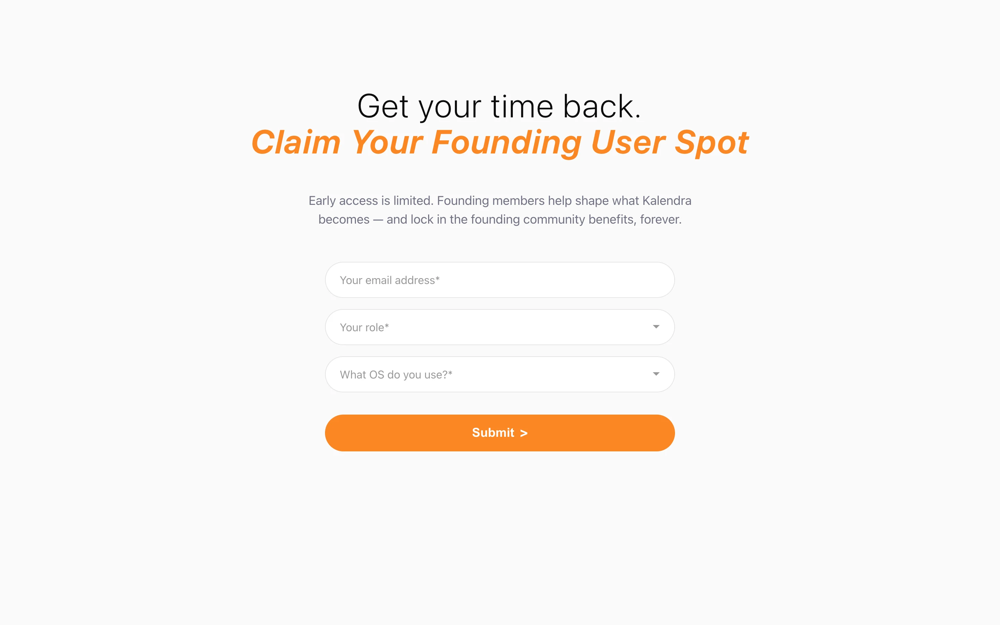 <b>Early access form</b> Email, role, OS</td>
    <td align="center">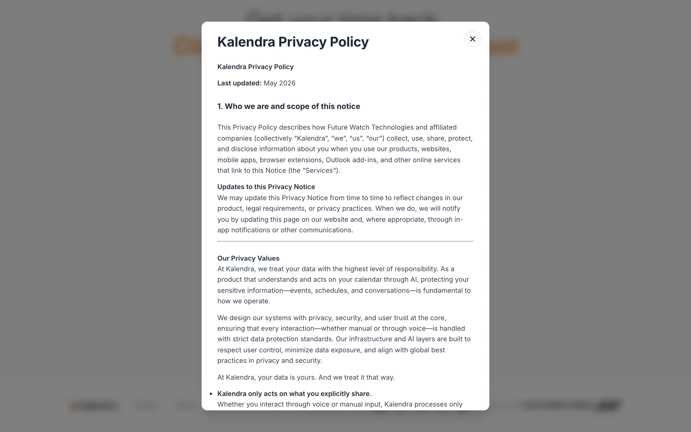 <b>Legal notices</b> Modal opened from a URL hash</td>
  </tr>
</table>

### Mobile (412 by 860)

<table>
  <tr>
    <td align="center">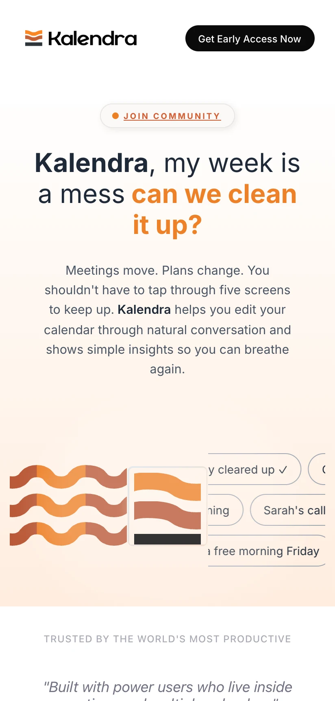 <b>Hero</b></td>
    <td align="center">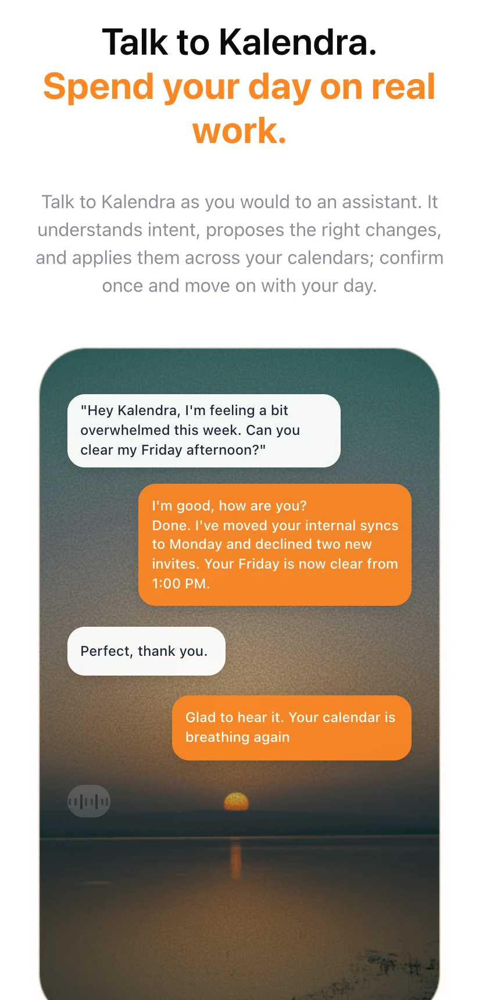 <b>Conversation</b> Separate stacked layout</td>
    <td align="center">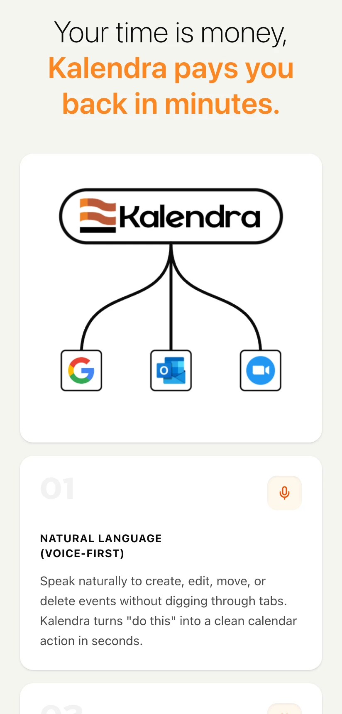 <b>Capabilities</b></td>
  </tr>
</table>

## Key Features

- **Conversational demo.** An animated chat in which a user asks Kalendra to clear a Friday afternoon and gets a reply. Each bubble starts as a small animated waveform, expands into a bubble and types its text, on a staggered timeline that loops every 35 seconds.
- **Capabilities diagram.** The Kalendra logo grows from a square into a pill, draws three curved lines and drops in Google, Outlook and Zoom icons. The curves are computed from a handful of numeric parameters.
- **Glass lens ticker.** A magnifier-style lens travels over a list of job titles. The distortion comes from an SVG `feTurbulence` and `feDisplacementMap` filter, driven by a `requestAnimationFrame` loop.
- **Hero motion.** A looping wave logo built from animated SVG paths, beside rows of suggestion chips that scroll continuously.
- **Scroll-driven underline.** GSAP ScrollTrigger draws an SVG underline under "finding focus" as the section enters view.
- **Waitlist form.** Email, role and OS (Android or iOS) are sent through EmailJS from the browser, with a locked "Submitted" state to discourage repeat sends.
- **In-page legal notices.** Privacy Policy and Terms are dialogs that follow the URL hash, so they can be linked to and survive back and forward navigation.

## Architecture

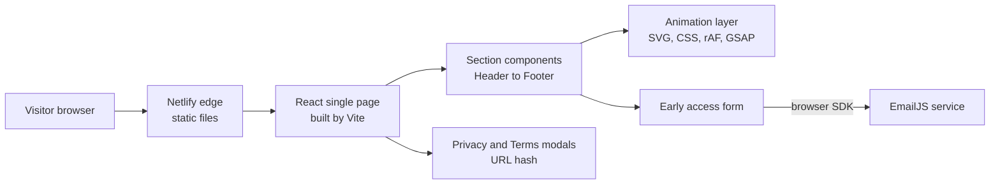

There is no server code: the build is static HTML, JavaScript and CSS. Details: [docs/ARCHITECTURE.md](docs/ARCHITECTURE.md).

## Engineering Highlights

### Animation without a media pipeline
Every moving element is code: SVG paths and `animateTransform`, CSS keyframes, a hand-written render loop and GSAP for one scroll effect. There are no video files or animation JSON, so the whole animated page ships in about 114 kB of gzipped JavaScript plus images.

### A distortion lens made from an SVG filter
The "Trusted by" ticker uses a lens whose edge distortion is an SVG turbulence and displacement filter, with blurred copies of the text outside the lens. Lens size, speed and font size are switched at a 768 px breakpoint.

### Parametric connector lines
The capabilities diagram builds its Bezier paths from a few parameters (width, segment lengths, control offsets, scale), so the same component can be re-tuned without redrawing artwork.

### A form that works with no server
The early-access form posts through EmailJS directly from the page and reads its identifiers from build-time environment variables, which are kept out of version control. It refuses to submit if they are missing and maps network errors to readable messages.

More: [docs/ENGINEERING_CHALLENGES.md](docs/ENGINEERING_CHALLENGES.md).

## Responsive and Accessibility Notes

Only what was verified in source or on the live site:

- Layout adapts at a 768 px breakpoint, with over 30 max-width media-query blocks across the stylesheets. At 412 px the page does not scroll horizontally (document width equals viewport width).
- The conversation section and its background image have separate mobile versions, selected with `<picture>` and a JavaScript check.
- Legal dialogs use `role="dialog"`, `aria-modal`, a labelled title, an accessible close button and Escape-to-close, and lock body scroll while open.
- Images carry alt text, and the document declares `lang="en"` with a title, description, Open Graph and Twitter card tags and a web manifest.

## Technology Stack

| Layer | Technology |
|---|---|
| UI | React 18 with function components and hooks |
| Build | Vite 5 with the React plugin |
| Styling | Hand-written CSS per section, no CSS framework |
| Animation | SVG and `animateTransform`, CSS keyframes, `requestAnimationFrame`, GSAP ScrollTrigger |
| Form delivery | EmailJS browser SDK |
| Typography | Inter via Google Fonts |
| Hosting | Netlify (static) |

## Documentation

| Read | For |
|---|---|
| [Product overview](docs/PRODUCT_OVERVIEW.md) | What the site shows and how a visitor moves through it |
| [Technical case study](docs/TECHNICAL_CASE_STUDY.md) | End-to-end write-up |
| [Architecture](docs/ARCHITECTURE.md) | Structure, runtime flows and diagrams |
| [Engineering challenges](docs/ENGINEERING_CHALLENGES.md) | Problem, approach, trade-off |
| [Privacy and source](docs/PRIVACY_AND_SOURCE.md) | What is and is not published |

## Source Code

This repository is a portfolio showcase for a production website. Production source code is maintained privately. See [RIGHTS.md](RIGHTS.md) for usage terms.
