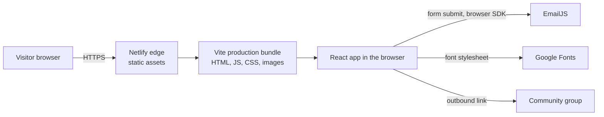
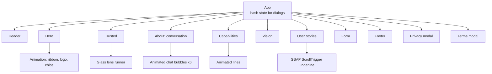
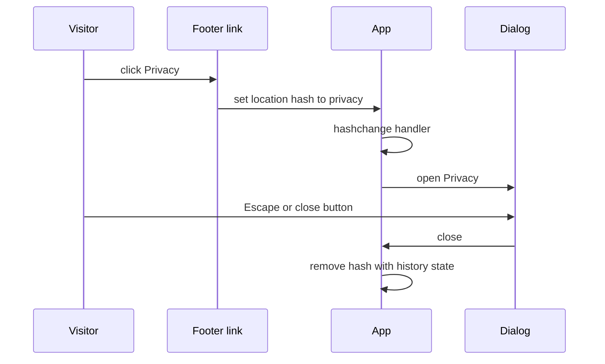

# Architecture

Diagrams are conceptual and describe responsibilities rather than exact file names.

## 1. System context

There is no application server, API or database owned by the site. The only runtime third parties are the EmailJS service (form delivery) and Google Fonts (Inter).

## 2. Component structure

Sections are self-contained folders with a component and a stylesheet, so a section can be changed without touching its neighbours. Shared animation pieces are reused across sections, for example the animated logo appears in both the hero and the capabilities diagram.

## 3. Legal dialog flow

The hash is also read on first load, so a direct link to the privacy notice opens it immediately, and browser back and forward move between states.

## 4. Animation layer

| Technique | Where | Why |
|---|---|---|
| SVG `animateTransform` | Hero wave ribbons | Continuous loop with no JavaScript per frame |
| CSS keyframes | Hero chips, bubbles, cards | Cheap, compositor-friendly movement |
| `requestAnimationFrame` plus state | Glass lens text, capabilities diagram | Needs per-frame values |
| Timers on a shared delay and loop value | Chat bubbles | Staggers six bubbles and resets them together every 35 seconds |
| GSAP ScrollTrigger | Underline in user stories | Scrubbed by scroll position |
| Interval typing | Vision statement, bubble text | Typewriter effect |

## 5. Build and hosting

- Vite builds a static bundle with hashed asset filenames.
- The live site is served by Netlify, confirmed from response headers. The source folder also carries a rewrite configuration for a different static host; only the Netlify deployment could be verified.
- Form identifiers are injected at build time from environment variables, which are not committed. Because this is a browser-only form, those values are visible in the shipped bundle, which is how this integration is designed to work.
